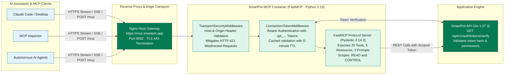

# SmartPot-MCP: connection and transport security

[English](#english) | [Español](#español)

## English

### Token validity cache

The HTTP edge validates the `spt_` format first, then calls `GET /api/v1/users/me` with the connection token. The verdict is cached in memory for 30 seconds (`MCP_TOKEN_CACHE_SECONDS`) keyed by the SHA-256 digest of the token; both positive and negative results are cached. A fake or revoked token receives `401` on every route, including `tools/list`, and a well-formed token never reaches a tool without validation. API 5xx or network failures return `503` and are not cached.

### Host and Origin

`AuthorityValidationMiddleware` parses `host[:port]` in lowercase, rejects userinfo, paths, deceptive suffixes (`localhost:28092.evil.example`), malformed ports (`localhost:99999`, `localhost:28092x`) and duplicate Host headers, and accepts IPv6 (`[::1]:28092`) when configured. `/health` stays public for container and Kubernetes probes. Origin, when present, must match an exact `MCP_ALLOWED_ORIGINS` entry or a `:*` wildcard; missing Origin is accepted for non-browser MCP clients.

CORS uses an explicit allowlist (exact origins plus a regex for wildcard ports), never `*`, with `allow_credentials=False` and explicit MCP headers.

### Architecture & Security Diagram

## Español

### Caché de validez de tokens

El borde HTTP valida primero el formato `spt_` y luego llama `GET /api/v1/users/me` con el token de conexión. El veredicto se cachea en memoria durante 30 segundos (`MCP_TOKEN_CACHE_SECONDS`) usando el SHA-256 del token como clave; se cachean tanto los resultados positivos como los negativos. Un token falso o revocado recibe `401` en todas las rutas, incluido `tools/list`, y un token bien formado nunca llega a una herramienta sin validación. Los 5xx de la API o las caídas de red devuelven `503` y no se cachean.

### Host y Origin

`AuthorityValidationMiddleware` analiza `host[:puerto]` en minúsculas, rechaza userinfo, rutas, sufijos engañosos (`localhost:28092.evil.example`), puertos mal formados (`localhost:99999`, `localhost:28092x`) y cabeceras Host duplicadas, y acepta IPv6 (`[::1]:28092`) cuando está configurado. `/health` sigue siendo público para los probes de contenedor y Kubernetes. El Origin, cuando existe, debe coincidir con una entrada exacta de `MCP_ALLOWED_ORIGINS` o un comodín `:*`; la ausencia de Origin se acepta para clientes MCP que no son navegador.

CORS usa una lista explícita (orígenes exactos más una regex para puertos comodín), nunca `*`, con `allow_credentials=False` y cabeceras MCP explícitas.
