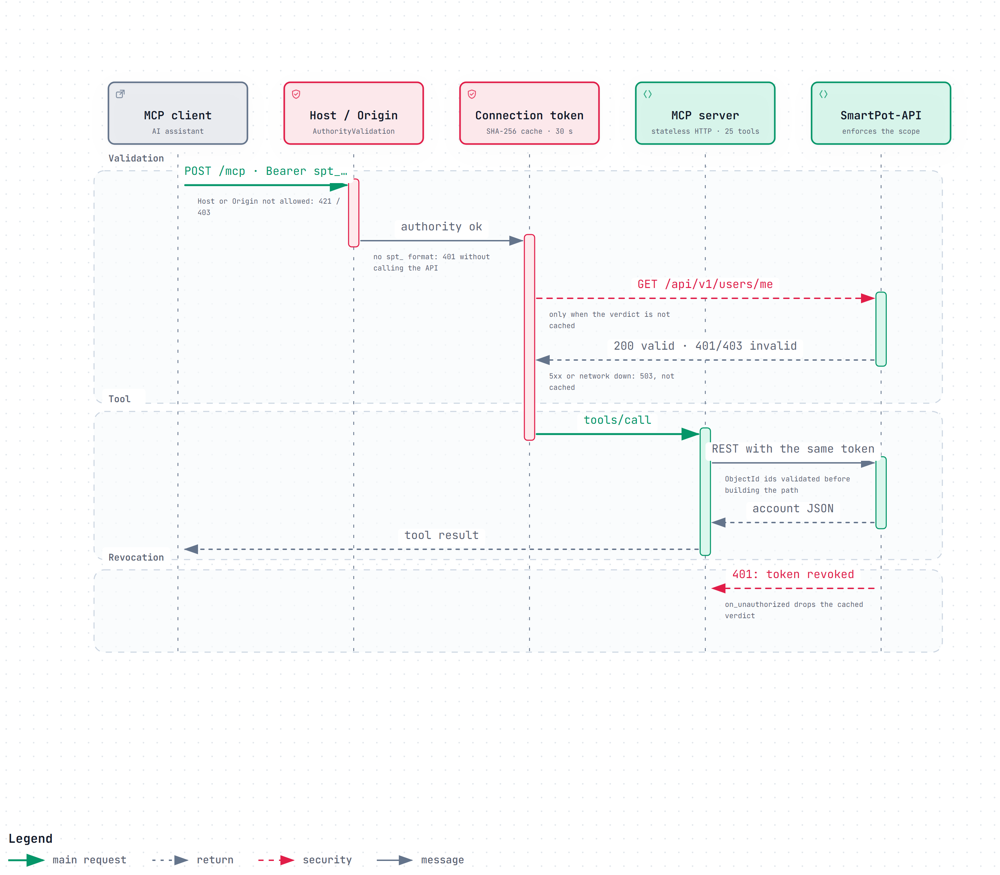

# SmartPot-MCP · Interactive Diagrams

[English](#english) | [Español](#español)

---

## English

Each diagram is a self-contained HTML page that works offline. Download it and open it in a browser to zoom, search nodes, trace a path and jump to the exact source lines on GitHub. The PNG preview is the light-theme render of the same diagram.

### 1. MCP Tool Call with an spt_ Token

The path of one streamable HTTP request: the authority middleware rejects a disallowed Host or Origin (421 / 403) before any token leaves the server, the connection-token middleware rejects anything that is not `spt_…` without calling the API, and `TokenValidator` asks SmartPot-API `GET /api/v1/users/me` only when the SHA-256 verdict is not cached for 30 seconds (a 5xx answers 503 and is never cached). The stateless MCP server then forwards the tool call to the API with the same token, so the API applies the account isolation and the read or control scope; a later 401 drops the cached verdict immediately.

- Interactive: [English](SmartPot_MCP_A1_Tool_Call_Sequence.en.html) · [Spanish](SmartPot_MCP_A1_Tool_Call_Sequence.es.html)
- Sources: `app/main.py`, `app/core/security.py`, `app/server/auth.py`, `app/server/mcp_server.py`, `app/client/api_client.py` and `README.md` at commit `e6371b5`.

---

## Español

Cada diagrama es una página HTML autocontenida que funciona sin conexión. Descárgala y ábrela en un navegador para ampliar, buscar nodos, seguir un recorrido y saltar a las líneas exactas del código en GitHub. La vista previa PNG es el mismo diagrama en tema claro.

### 1. Llamada a una herramienta MCP con token spt_

El recorrido de una petición HTTP: el middleware de autoridad rechaza un Host u Origin no permitido (421 / 403) antes de que ningún token salga del servidor, el middleware de tokens rechaza lo que no sea `spt_…` sin llamar a la API y `TokenValidator` consulta `GET /api/v1/users/me` en SmartPot-API solo si el veredicto SHA-256 no está en caché durante 30 segundos (un 5xx responde 503 y nunca se guarda). Después el servidor MCP sin estado reenvía la herramienta a la API con el mismo token, de modo que la API aplica el aislamiento por cuenta y el alcance de lectura o control; un 401 posterior borra el veredicto en caché al instante.

- Interactivo: [inglés](SmartPot_MCP_A1_Tool_Call_Sequence.en.html) · [español](SmartPot_MCP_A1_Tool_Call_Sequence.es.html)
- Fuentes: `app/main.py`, `app/core/security.py`, `app/server/auth.py`, `app/server/mcp_server.py`, `app/client/api_client.py` y `README.md` en el commit `e6371b5`.

